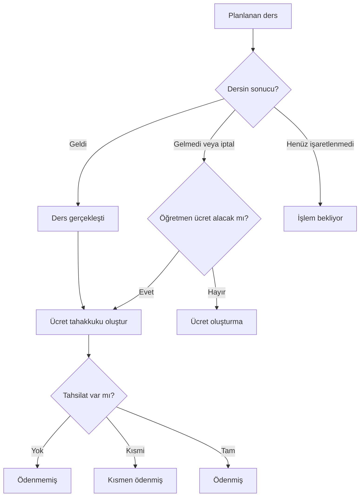

> **Güncelleme (2026-11-22):** Genel kapsam için `02-fonksiyonel-gereksinimler.md`, geçerli geliştirme planı için `09-yol-haritasi.md` esas alınır. Bu belgedeki örnek mimari ve API kararları taslaktır.

# 03 — İş kuralları, durumlar ve sınırlar

## Dersin durumları ayrı tutulmalı

Tek `Status` alanına tüm kavramları sıkıştırma. Önerilen ayrım:

1. **Planlama durumu:** `Scheduled`, `Rescheduled`, `Cancelled`.
2. **Katılım durumu:** `Pending`, `Attended`, `Absent`, `NotApplicable`.
3. **Ücret kararı:** `Pending`, `Charge`, `Waive` (katılmama/iptal için öğretmen seçer).
4. **Tahsilat durumu:** Ayrı doğrudan kaydedilmez; açık tahakkuk tutarı ve ödeme dağıtımlarından **hesaplanır** (`Unpaid`, `PartiallyPaid`, `Paid`).

Gerçek modelde durum birleşimlerini gereksiz yere çoğaltmamak için geçiş kuralları tanımla.

## Temel akış

## İş kuralları

- `BR-01`: Ders saatinin bitmesi yoklamayı otomatik olarak `Attended` yapmaz.
- `BR-02`: Gelmeme/iptal durumunda öğretmen ücret kararını **ders bazında** verir; varsayılan otomatik borç oluşturulmaz.
- `BR-03`: Ücret kararını tamamlamayan ders finansal bakımdan **bekleyen işlem** olarak kalır.
- `BR-04`: Gerçekleşen dersin planlanan ücreti snapshot olarak alınır; özel indirim veya ücret düzenlemesi ayrıca kayıt altına alınmalıdır.
- `BR-05`: Öğrenci-ders türü ücret güncellemesi geçmiş ders ücretlerini geriye dönük değiştirmez.
- `BR-06`: Tahsilat, tahakkuktan ayrıdır; birden fazla tahakkuka dağıtılabilir.
- `BR-07`: Toplam dağıtım tutarı ödeme tutarını aşamaz; tahakkuka dağıtılan toplam tutar tahakkuk bakiyesini aşamaz (ön ödeme senaryosu ayrıca tasarlanmadıkça).
- `BR-08`: Para hesabında `decimal` kullan; `float/double` kullanma.
- `BR-09`: İptal, arşiv ve ödeme düzeltmeleri için denetim geçmişi tutulur.
- `BR-10`: Tamamlanmış/finansal işlem görmüş dersin taşınması ve silinmesi sınırlanır; geçmiş ödeme ilişkileri bozulamaz.
- `BR-11`: Taslak gerçek ders değildir; onaylanmadıkça raporlara, tahakkuka veya aktif takvime kesin ders olarak eklenmez.
- `BR-12`: Sabit ders algoritma tarafından taşınamaz; seçilmeyen diğer haftalara dokunulmaz.
- `BR-13`: Öğrenci arşivlense bile geçmiş dersler ve finansal kayıtlar korunur; kişisel veri saklama/silme yükümlülükleri ayrıca ele alınır.
- `BR-14`: Öğretmenin erişim yetkisi her işlemde sunucu tarafında doğrulanır; gelen `TeacherId` değerine güvenilmez.
- `BR-15`: Aynı ders için gereksiz tekrarlanan tahakkuk oluşmaz; özgün ilişki veya işleme özel kimlik kullanılır.

## Örnek durum tablosu

| Olay | Katılım | Ücret kararı | Tahakkuk | Tahsilat |
|---|---|---|---|---|
| Öğrenci geldi, ödeme yapmadı | Attended | Charge | 1.000 TL | 0 TL |
| Öğrenci geldi, 600 TL verdi | Attended | Charge | 1.000 TL | 600 TL |
| Öğrenci gelmedi, öğretmen ücret istiyor | Absent | Charge | 1.000 TL | 0 TL (sonra alınabilir) |
| Öğrenci gelmedi, ücret alınmayacak | Absent | Waive | 0 TL | 0 TL |
| Ders bitti, öğretmen hiç işlem yapmadı | Pending | Pending | Beklemede | Kayıt yok |

## Değişiklik izleri ve ücret düzeltmeleri

Ücret zaten bir ödeme ile kapatılmışsa tahakkuk tutarını doğrudan sıfırlamak yerine düzeltme/iade alacak senaryosu tasarlanmalı. İlk sürümde bu tür işlemler için güvenli kontrol ve açık hata mesajı gerekir; iade iş akışı ayrıca karara bağlanır.
