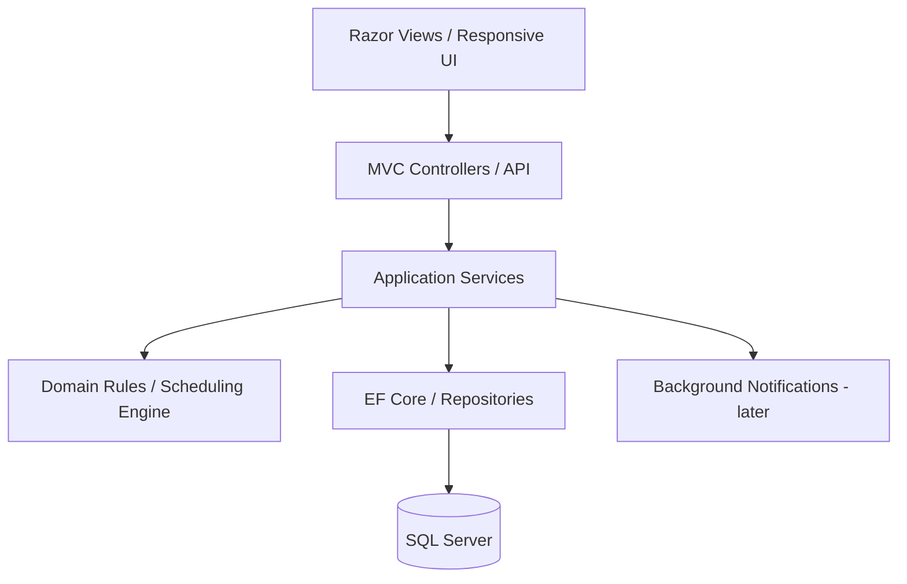
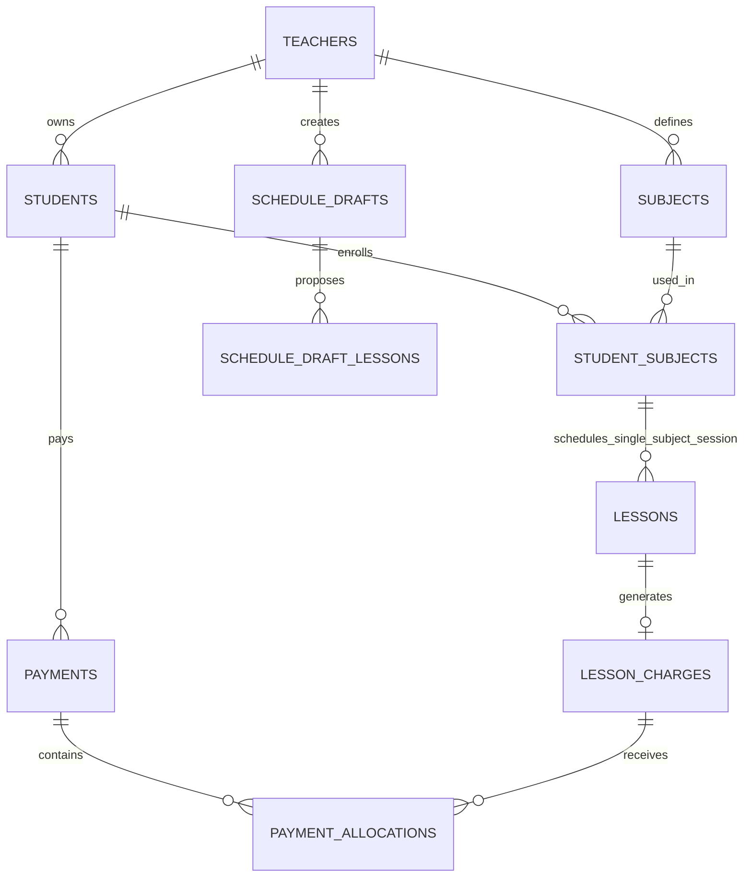

> **Güncelleme (2026-11-22):** Genel kapsam için `02-fonksiyonel-gereksinimler.md`, geçerli geliştirme planı için `09-yol-haritasi.md` esas alınır. Bu belgedeki örnek mimari ve API kararları taslaktır.

# 05 — Mimari ve veri modeli (taslak)

## Uygulama katmanları



Controller yalnızca HTTP doğrulaması/koordinasyonu yapar; program optimizasyonu ve para hesapları servis/domain içinde olmalı. Öğretmen kimliği sunucu tarafındaki oturumdan alınmalı. MVC ve ileride API aynı iş servislerini paylaşabilir.

## Önerilen çözüm düzeni

```text
src/
  OzelDers.Web/             # MVC Views, Controllers, wwwroot
  OzelDers.Application/     # Use cases, DTO/commands, validation
  OzelDers.Domain/          # Entities, enums, iş kuralları
  OzelDers.Infrastructure/  # EF Core, Identity, entegrasyonlar
  OzelDers.Scheduling/      # Kısıt çözücü/optimizasyon
 tests/
  OzelDers.UnitTests/
  OzelDers.IntegrationTests/
 docs/
```

Bu katmanlama öneridir; ilk commit'te basitleştirilebilir, ancak bağımlılık sınırları korunmalı.

## Çekirdek tablolar ve önerilen alanlar

Bütün tablolar için uygun `Id`, `CreatedAt`, `UpdatedAt` ve concurrency sürümü düşünülür. Aşağıdaki alanlar mantıksal taslaktır; migrasyon öncesi netleştirilecek.

| Tablo | Ana alanlar ve ilişkiler |
|---|---|
| `Teachers` | `Id` (Identity kullanıcıyla ilişki), `DisplayName`, `TimeZoneId` |
| `Students` | `Id`, `TeacherId`, `FirstName`, `LastName`, `Phone?`, `Email?`, `IsArchived`, `Notes?` |
| `Subjects` | `Id`, `TeacherId`, `Name`, `IsDefault`, `IsArchived` |
| `StudentSubjects` | `Id`, `StudentId`, `SubjectId`, `HourlyRate decimal(18,2)`, `DefaultDurationMinutes` (oturum süresi), `WeeklyTargetCount` (haftalık ayrı oturum sayısı), `IsActive` |
| `TeacherAvailabilities` | `Id`, `TeacherId`, `DayOfWeek`, `StartLocalTime`, `EndLocalTime` |
| `StudentAvailabilities` | `Id`, `StudentId`, `DayOfWeek`, `StartLocalTime`, `EndLocalTime` |
| `AvailabilityExceptions` | `Id`, `TeacherId`, `StudentId?`, `Date`, `IsAvailable`, `StartLocalTime?`, `EndLocalTime?`, `Reason?` |
| `Lessons` | `Id`, `StudentSubjectId` (tek öğrenci–ders türü bağı; `StudentId`/`SubjectId`/`TeacherId` tekrarı tutulmaz), `StartUtc`, `EndUtc`, `FeeSnapshot`, `PlanningStatus`, `AttendanceStatus`, `FeeDecision`, `IsLocked`, `RecurringRuleId?`, `SourceDraftId?`, `RowVersion` |
| `LessonCharges` | `Id`, `LessonId` (unique for initial model), `Amount decimal(18,2)`, `State`, `Reason?` |
| `Payments` | `Id`, `TeacherId`, `StudentId`, `Amount decimal(18,2)`, `ReceivedAtUtc`, `Method?`, `Note?`, `VoidedAtUtc?` |
| `PaymentAllocations` | `Id`, `PaymentId`, `LessonChargeId`, `Amount decimal(18,2)` |
| `ScheduleDrafts` | `Id`, `TeacherId`, `WeekStartDate`, `Status`, `Version`, `InputFingerprint`, `CreatedAt`, `ApprovedAt?` |
| `ScheduleDraftLessons` | `Id`, `DraftId`, `ExistingLessonId?`, `StudentId`, `SubjectId`, `StartUtc`, `EndUtc`, `Action(New/Move)`, `ValidationStatus` |
| `RecurringLessons` | `Id`, `TeacherId`, `StudentId`, `SubjectId`, `DayOfWeek`, `StartLocalTime`, `DurationMinutes`, `ValidFrom`, `ValidTo?` |
| `TeacherSettings` | `TeacherId`, `DefaultDurationMinutes`, `MinimumBreakMinutes`, `MaxDailyTeachingMinutes`, `NotificationsEnabled` |
| `Notifications` | `Id`, `TeacherId`, `Type`, `ReferenceId?`, `CreatedAt`, `ReadAt?` |
| `AuditLogs` | `Id`, `TeacherId`, `ActorId`, `EntityType`, `EntityId`, `Action`, `OccurredAt`, `ChangeSummary` |

### Önemli kararlar

- Öğretmen kayıt olurken en az bir ders türü tanımlamak zorundadır ve ilk ders otomatik olarak varsayılan (`Subjects.IsDefault = true`) olur.
- Bir öğrenciye birden fazla ders türü (`StudentSubjects`) atanabilir; ancak **her ders oturumu (`Lessons`) yalnızca tek bir `StudentSubjectId` kaydına bağlanır** (tek bir ders oturumuna birden fazla ders türü atanamaz).
- Gereksiz veri tekrarından ve çelişki riskinden kaçınmak için `Lessons` tablosunda `StudentId`, `SubjectId` ve `TeacherId` sütunları tekrar tutulmaz; tüm sahiplik ve ders türü bilgisi `StudentSubjectId -> StudentSubjects -> (Student, Subject)` üzerinden tek kaynaktan elde edilir.
- `StudentSubjects.WeeklyTargetCount` haftalık ayrı ders oturumu adedini, `DefaultDurationMinutes` ise her bir oturumun dakika cinsinden süresini ifade eder (örn. haftada 2 oturum × 60 dk ile 1 oturum × 120 dk birbirinden farklıdır).
- Ders türü, öğrencinin ilişkili olduğu öğretmenin ders türü olmalıdır (`Student.TeacherId == Subject.TeacherId`). Aynı öğretmene aitlik kontrolleri zorunludur.
- `FeeSnapshot`, geçmiş dersin ücretinin güncel öğrenci ücretinden veya varsayılan ders değişikliğinden etkilenmemesini sağlar.
- Katılım ve planlama ayrı durumlar; parasal ödeme durumu tahakkuk ve dağıtımdan türetilir.
- Öğrenciyi arşivlemek dersleri/ödemeleri silmez.
- Tahsilat kaydedildikten sonra silmek yerine düzeltme/void işlemi ve iz bırakma uygundur.
- Zaman aralıkları `[start,end)` olarak düşünülür; 10.00–11.00 ve 11.00–12.00 doğrudan çakışmaz, ancak zorunlu mola varsa ayrı kural uygulanır.
- Takvimde UTC saklama + kullanıcı saat dilimine dönüştürme tercih edilir. Saat dilimi ve yaz saati geçişlerinde test yapılmalıdır.

## Basitleştirilmiş ilişki diyagramı



## Veri bütünlüğü ve sorgulama

- İndeksler: `Lessons(StudentSubjectId, StartUtc)`, `Students(TeacherId, IsArchived)`, `Subjects(TeacherId, IsArchived)`, `ScheduleDrafts(TeacherId, WeekStartDate, Status)`, `Payments(StudentId, ReceivedAtUtc)`.
- Unique:
  - Öğretmen bazında ders türü adı (`IX_Subjects_TeacherId_Name` — arşivlenmiş bir ders yeniden aynı adla eklenmek istendiğinde mükerrer satır açmak yerine mevcut arşivli kayıt yeniden etkinleştirilir).
  - Öğretmen başına en fazla bir aktif varsayılan ders (`IX_Subjects_TeacherId_IsDefault WHERE IsDefault = 1 AND IsArchived = 0`); en az bir aktif ders varken mutlaka bir varsayılan ders bulunması kuralı servis katmanında korunur.
  - Öğrenci başına ders türü tekilliği (`IX_StudentSubjects_StudentId_SubjectId`).
  - Tahakkuk için ders başına uygun benzersizlik; taslak onay idempotency anahtarı.
- Çakışma kontrolü: `existing.StartUtc < candidate.EndUtc && candidate.StartUtc < existing.EndUtc` (iptaller hariç).
- **Yalnızca uygulama katmanında ön kontrol yeterli değildir**; eşzamanlı onay/manuel ekleme yarışını transaction, uygun yalıtım/kilit veya benzeri güvenli stratejiyle önle.
- İlgili öğretmen, öğrenci ve ders türünün sahiplik kontrolleri hem sorgulamada hem kaydetmede gereklidir.
- İleriye dönük veri saklama süresi, gerçek kişisel veri kullanımı ve silme talepleri ayrıca politika gerektirir.
