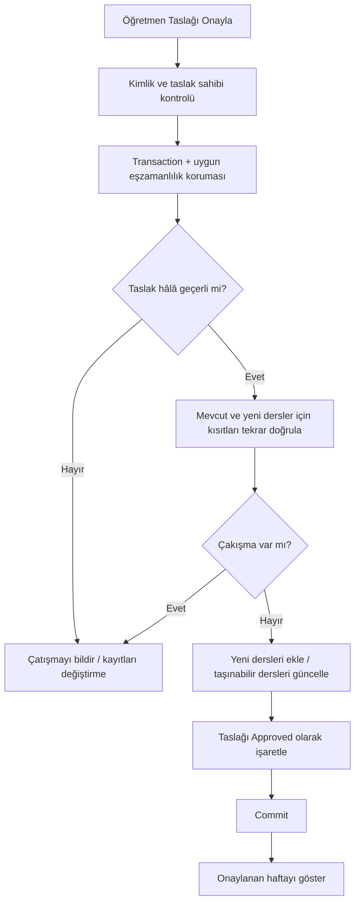

> **Güncelleme (2026-11-22):** Genel kapsam için `02-fonksiyonel-gereksinimler.md`, geçerli geliştirme planı için `09-yol-haritasi.md` esas alınır. Bu belgedeki örnek mimari ve API kararları taslaktır.

# 06 — Tek haftalık otomatik programlama ve onay

## Amaç

Seçilen **tek hafta** için öğrenci hedef derslerini, öğretmen/öğrenci müsaitliklerini, mevcut sabit ve değişebilir dersleri gözeterek geçerli bir öneri üretmek. Algoritma kullanıcı onayı olmadan canlı dersi değiştirmez.

## Girdi

- `TeacherId` (oturumdan), `WeekStart` (pazartesi), saat dilimi
- Öğretmenin izin verdiği tarih/saat aralıkları, istisnaları, minimum mola, günlük maksimum süre
- Seçili aktif `StudentSubject`: öğrenci, tür, istenen ders adedi, ders süresi, ücret
- Her öğrencinin düzenli ve haftaya özel müsaitlikleri
- O haftanın mevcut dersleri; her biri `Fixed` veya `Movable`
- Opsiyonel tercih ağırlıkları: boşlukları azalt, belirli günleri daha az doldur, erken/geç saat tercihleri

## Zorunlu kısıtlar (hard constraints)

1. Tek planlanan hafta sınırları içinde kalma.
2. Öğretmen/öğrenci uygunluk aralıkları içinde kalma; istisnaları uygulama.
3. Dersler arasında çakışma olmaması; zorunlu minimum mola.
4. Sabit ders saatlerinin değişmemesi.
5. Değişebilir mevcut dersin tek bir yeni konumu olması (çoğaltılmaz).
6. Ders sürelerinin ve öğrenci ders türü ilişkisinin geçerli olması.
7. Öğretmenin günlük maksimum ders süresi gibi zorunlu sınırlara uyulması.
8. Mevcut dersin tamamlanmış, ücretlendirilmiş veya ödeme ile ilişkilendirilmişse otomatik taşınmaması (gerekirse kilitli say).

## Tercihler (soft constraints)

- Gün içi boşlukları azaltma
- Mümkün oldukça öğrencinin tercih ettiği saatleri seçme
- Günlük yükü dengeleme
- Arka arkaya ders veya günleri boş bırakma isteğini değerlendirme

Uygun tüm dersler yerleştirilemiyorsa algoritma kısmi öneri sunabilir, **eksik dersleri ve gerekçelerini** açıkça göstermelidir. Öğretmen açıkça kısmi öneriyi onaylayabilir mi? **Açık karar — bkz. 11**.

## Önerilen başlangıç stratejisi

1. Tarih/saat diliminde slotları (örn. 30 dakika adımlarla) oluştur.
2. Sabit dersleri ve kullanılamayan aralıkları takvime yerleştir.
3. Değişebilir dersleri ve yeni ders ihtiyaçlarını görev listesine dönüştür.
4. Her görev için geçerli slotları çıkar.
5. En az seçeneği olan görevi önce ele al (`minimum remaining values`).
6. Backtracking/branch-and-bound ile yerleştir; uygunsuz dalı erken kes.
7. Birden çok çözüm varsa yumuşak kısıt puanına göre sırala.
8. Taslağı, eksik talepleri ve toplam puan bilgisini döndür.

### Dil bağımsız sözde kod

```text
GenerateWeek(teacher, week, fixedLessons, movableLessons, requirements):
    slots = BuildSlots(teacher.workingHours, week, exceptions)
    occupied = ReserveFixedLessons(fixedLessons)
    tasks = BuildTasks(movableLessons, requirements)
    candidates = MapEachTaskToValidSlots(tasks, slots, occupied)
    result = SolveWithBacktracking(tasks, candidates, hardConstraints, softScore)
    return Draft(proposedLessons=result.placed, unscheduled=result.missing)
```

## Taslak yaşam döngüsü

`Draft` → `Validated` → `Approved`, veya `Draft` → `Discarded`, veya `Draft` → `Stale/Conflict`.

- Taslakta yeni ders için `ExistingLessonId = null`; taşınan ders için ilgili mevcut dersin ID'si tutulur.
- Taslakta mevcut derslerin **önceki ve önerilen** zamanları arayüzde gösterilir.
- Her düzenlemede taslak sürümü artırılır, sunucu tarafında yeniden doğrulanır.
- Alternatif öneri önceki taslağı silmek zorunda değildir; yeni sürüm/ayrı taslak oluşturabilir.

## Onay akışı (kritik)



### Transaction içinde dikkat edilecekler

- Taslağın sahibi ve `WeekStart` doğrulanır.
- Taslak önceden onaylandıysa yeni ders eklemek yerine mevcut onay sonucunu döndür (idempotency).
- Taslağın sürümü, kullanılan dersler, müsaitlik ve çalışma ayarlarının hâlâ güncel olup olmadığı kontrol edilir.
- Çakışmalar **canlı veriye** göre tekrar hesaplanır; uygun transaction izolasyonu veya kilit yöntemiyle aynı anda yeni çakışma eklenmesi önlenir.
- Var olan taşınabilir dersler mevcut `LessonId` ile güncellenir; sabit ve tamamlanmış dersler korunur.
- Tüm kaydetme işlemleri ya tamamen başarılı olur ya rollback edilir.

## Örnek

Öğretmen: pazartesi–cuma 09.00–18.00. Ayşe salı/perşembe gelemiyor, haftada iki ders; Mehmet her gün 13.00–18.00, haftada iki ders. Pazartesi 10.00'daki sabit ders değişemez. Algoritma kalan dersleri uygun zamanlara yerleştirir, çakışma yoksa taslağı sunar. Öğretmen onaylamazsa takvim aynı kalır.

## Kabul testleri

- Sabit dersin zamanı hiçbir öneride değişmemeli.
- Bir haftayı onaylamak bitişik haftadaki dersi değiştirmemeli.
- İki öğrenci aynı anda tek öğretmenin takvimine yerleştirilmemeli.
- Öğrenci uygun olmadığı gün ders almamalı.
- Onay öncesi manuel yeni ders girilmişse çakışan taslak reddedilmeli.
- Onay iki kez gönderilse yalnızca bir kez kayıt oluşmalı.
- Onayın ortasında hata olursa hiçbir kısmi kayıt kalmamalı.
- Uygun çözüm yoksa neden ve eksik ders sayısı gösterilmeli.
